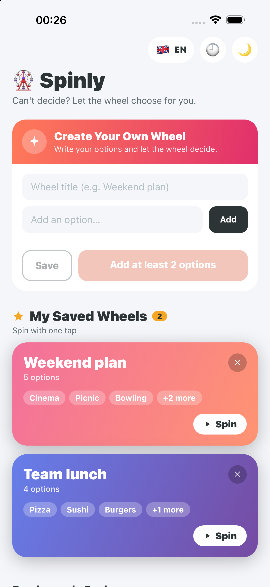
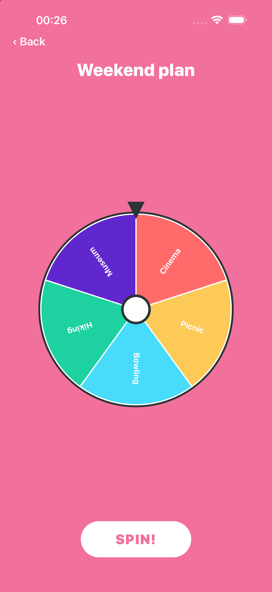
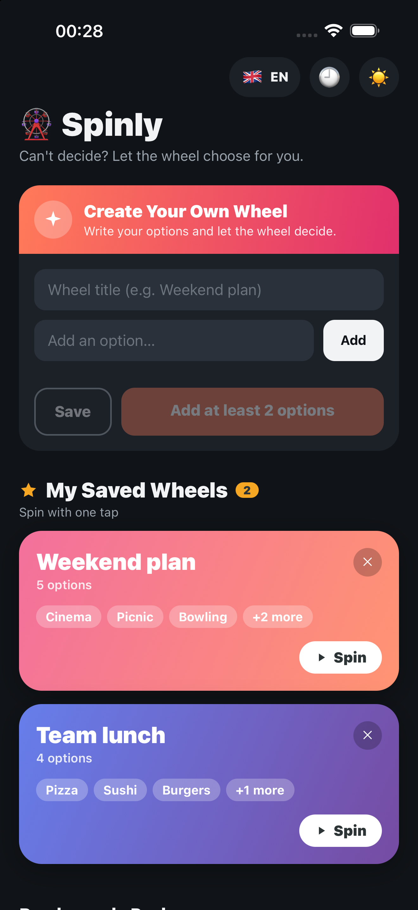

# Spinly: Decision Wheel

A cross-platform mobile app that helps you decide anything with a spin. Built with React Native and Expo for iOS and Android.

<p align="center">
  
  
  
  
</p>

**Status:** submitted to the App Store, awaiting review. Google Play release in preparation.

## Features

- Animated spinning wheel with sound and haptic feedback
- Ready-made packs: what to eat, watch, do, play or drink
- Custom wheels you can create, save and spin again with one tap
- Spin history with date and time
- Four color palettes, light and dark themes
- English and Turkish, following the device language

## Tech stack

| Area | Tools |
| --- | --- |
| Framework | React Native 0.86, Expo SDK 57 |
| Animation | React Native Reanimated, React Native SVG |
| Storage | AsyncStorage (all data stays on the device) |
| Device APIs | expo-haptics, expo-audio, expo-localization |
| Build and release | EAS Build and EAS Submit |

## Project structure

```
App.js                 App entry, providers and navigation
src/screens/           Home, Wheel and History screens
src/components/        Wheel renderer, icons and shared UI
src/data/              Built-in packs and color palettes
src/i18n/              English and Turkish translations
src/storage/           Local persistence for wheels and history
src/theme/             Light and dark themes
src/config/features.js Feature flags (the Pro tier is turned off for v1.0)
store/                 App Store and Google Play listings and screenshots
```

## Run locally

```bash
npm install
npx expo start
```

Then open the app in Expo Go, an iOS simulator or an Android emulator.

## Privacy

Spinly collects no personal data. See the [privacy policy](https://github.com/ErayU06/spinly-privacy/blob/main/PRIVACY.md).

## Author

Eray Ulusoy · [erayulusoy.com](https://erayulusoy.com)
